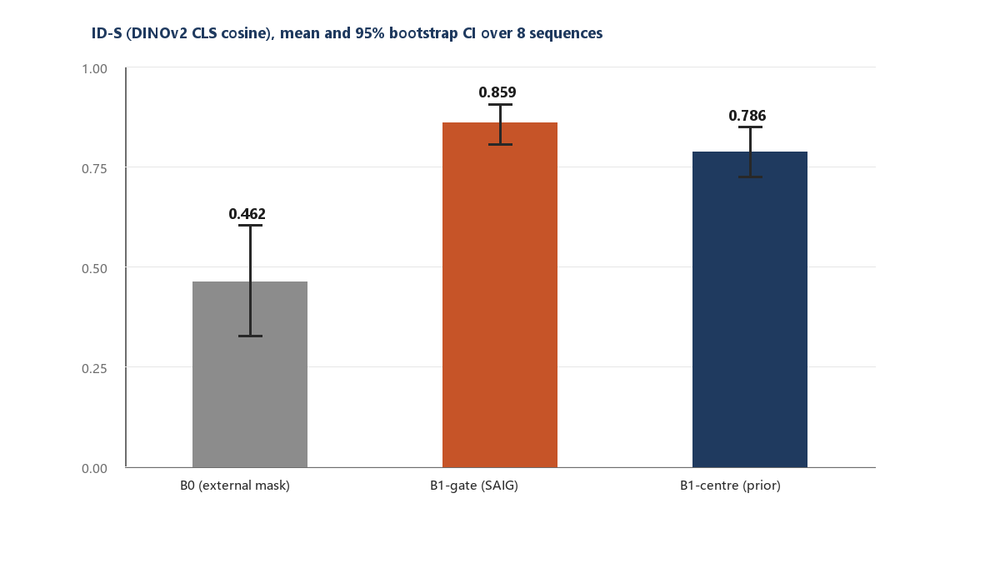

# Where Should the Keep-Mask Come From?

Code and measurement tables for the study **“Where Should the Keep-Mask Come From? A Controlled Study of Mask Sources in Training-Free Video Editing”** (manuscript prepared for *The Visual Computer*).

The repository contains the analysis scripts, the per-sequence measurement tables, and a verification script that recomputes every headline number in the paper **without a GPU**. The large artefact bundle (39 output videos, `g_id` arrays, gate maps, per-run logs, 45.7 MB) is distributed separately — see [`docs/DATA.md`](docs/DATA.md).



*Identity similarity (ID-S) of the three arms over eight DAVIS sequences, with 95% bootstrap intervals. Both gates raise identity far above the external mask; the attention gate is only marginally ahead of a parameter-free spatial prior.*

## At a glance

| Question | Answer |
|---|---|
| Is attention mass an object selector? | No — AUROC 0.617 against 0.914 for a centred Gaussian that never sees the image |
| Does a better gate fix the videos? | No — a +0.19 AUROC improvement changes ID-S by at most 0.023 |
| Can any of the 108 sweep cells beat the prior? | No — best cell 0.860, still below 0.914 |
| Is the negative result an artefact of the multiplicative gate? | No — removing the mask collapses ID-S to 0.01–0.06; an oracle mask and a boundary-refined mask do not beat the external mask |
| What should practitioners do instead? | Keep the external mask; if cost matters, refine its boundary, do not replace it with attention mass |

---

## What the study asks

Training-free video editors such as FADE delegate the decision of *what must be preserved* to an external segmentation mask. We treat that mask source as the experimental variable and compare three sources under an otherwise identical pipeline (same prompts, input clip, DDIM inversion trajectory, step count, resolution):

| Arm | Mask source |
|---|---|
| **B0** | external text-referenced segmentation (the original FADE mask) |
| **B1-gate** | self-attention mass to the first latent frame, `mask ⊙ (1 − α·g_id)`, α = 0.5 |
| **B1-centre** | parameter-free centred Gaussian (sees neither video nor model) |

## Headline numbers

| Quantity | Value |
|---|---|
| AUROC(gate) vs subject mask, 8 DAVIS sequences | **0.617** [95% CI 0.583, 0.655] |
| AUROC(centred Gaussian) | **0.914** [0.871, 0.951] |
| Paired difference (gate − prior) | **−0.297** [−0.337, −0.252] |
| ID-S: B0 / gate / centre | **0.462 / 0.859 / 0.786** |
| gate − centre (per-sequence) | **+0.073** [0.035, 0.116], 7/8 sequences, sign test p = 0.035 |
| 108-cell sweep (layers × reference frames × head aggregations) | max **0.860**; no cell beats the prior |

The conclusion is scoped to CogVideoX-5b, the four patched layers ({2,3} kept), and DAVIS-style centred subjects.

## Verify the numbers in one command (no GPU)

```bash
python verify_numbers.py
```

It re-reads `data/` and asserts the means, ranges, row counts and confidence intervals used in the paper. Expected output ends with `ALL NUMBERS VERIFIED`.

## Reproduce the experiments (GPU required)

See [`docs/REPRODUCE.md`](docs/REPRODUCE.md). Short version:

1. Build the environment (`requirements.txt`, CogVideoX-5b, DAVIS-2017 480p).
2. Apply the five patches with `scripts/apply_saig_patches.py` and `scripts/patch_guider_saig_gate.py`.
3. Run `scripts/auroc_gid.py` on the exported `g_id` arrays → expect `MEAN_AUC_GID 0.6171`, `GATE_AUROC FAIL`.
4. Run `scripts/metrics_compare.py` for the video-level arms.

> **Version note.** `scripts/metrics_compare.py` is the exact revision (2025-11-18) that produced the published numbers. A later internal revision changed the annotation-enumeration order and the crop list, which shifts ID-S by up to 0.02; the released tables were produced with the file shipped here.

## Repository layout

```
scripts/     5 paper-facing entry points + pipeline/ · analysis/ · figures/ · ops/
             (index: scripts/README.md)
data/        measurement tables behind every number and figure (index: data/README.md)
figures/     paper figures (Fig. 1-4) and the social preview card
docs/        REPRODUCE.md (full pipeline) · DATA.md (artefact bundle)
verify_numbers.py   recomputes the paper numbers from data/
```

## Data and artefacts

All primary measurements are in `data/`. The artefact bundle with the 39 rendered videos, `g_id` arrays, gate maps and per-run logs is archived separately; its contents, size and SHA256 are listed in [`docs/DATA.md`](docs/DATA.md).

The study uses the publicly released **DAVIS 2017** and **YouTube-VOS** datasets under their original licences. Derived frames and videos are redistributed for research reproducibility only; please observe the dataset licences.

## Licence

Code: MIT (see `LICENSE`); third-party notices and dataset terms are in `NOTICE`. The pipeline builds on FADE (MIT) and HybridGL; the text of the manuscript is not part of this repository.

## Contact

Corresponding author: *[to be filled]*

## Cite this

```bibtex
@software{saig_keepmask_2026,
  title  = {Where Should the Keep-Mask Come From? Code, measurement tables and artefact bundle},
  year   = {2026},
  note   = {Version 1.5},
  url    = {https://github.com/bl8914489-a11y/saig-mask-source}
}
```

When the paper is published, please cite the article instead; the repository metadata is also in `CITATION.cff`.

## What is deliberately *not* here

- Model weights (CogVideoX-5b, SAM ViT-H) and the DAVIS dataset — download from their official sources, see `docs/REPRODUCE.md`.
- The artefact bundle — attached to release `v1.5.1` (45.7 MB, SHA256 `1cf07ae1…b9bc`).
- The manuscript sources — kept out so that the code repository stays a code repository.